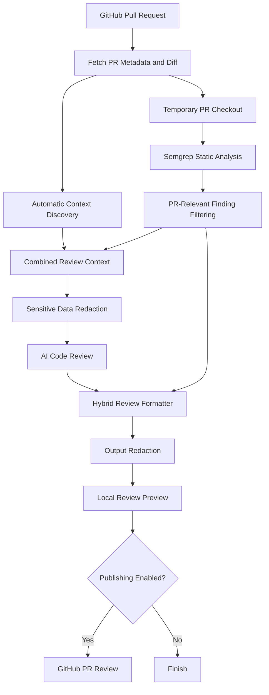

# ai-pr-governor
AI-powered pull request review and governance system combining LLM reasoning, static analysis, and risk-based controls.

- Hybrid code review combining AI reasoning with Semgrep static analysis.
- Temporary repository checkout at the exact pull request commit.
- Automatic cleanup of temporary repository files.
- File-level and line-level filtering of static analysis findings.
- Independent reporting of AI and static analysis findings.
- Sensitive credential redaction before AI requests and review publishing.
- Configurable OpenAI model selection.
- Human-in-the-loop review with explicit publishing controls.

## Review Pipeline

AI PR Governor combines deterministic static analysis with
context-aware AI reasoning.



Static analysis findings are preserved independently of the
AI response, ensuring that rule-based security evidence
remains visible to human reviewers.

### Static Analysis

Semgrep OSS is required for hybrid code reviews.

Install on macOS:

```bash
brew install semgrep
```

Verify the installation:

```bash
semgrep --version
```

The application uses Semgrep's automatic rule configuration.
An internet connection may be required to retrieve rules.


## Running a Hybrid Review

Build the application:

```bash
npm run build
```

Run a hybrid review without publishing to GitHub:

```bash
PUBLISH_REVIEW=false SKIP_AI_REVIEW=false node --env-file=.env dist/index.js
```

Run static analysis independently, without calling OpenAI:

```bash
node --env-file=.env dist/analysis/test-scan.js
```

Run a hybrid review and publish it to GitHub:

```bash
PUBLISH_REVIEW=true SKIP_AI_REVIEW=false node --env-file=.env dist/index.js
```

Publishing is disabled by default. Published reviews are
informational and do not automatically approve pull requests
or request changes.

Repeated publishing may create duplicate reviews.


## Security and AI Governance

AI PR Governor implements multiple safeguards around
AI-assisted code review:

- Rule-based static analysis complements AI reasoning.
- Original Semgrep findings and severity levels are preserved.
- Repository content is treated as untrusted input.
- Recognized credential patterns are redacted before AI
  requests and review output.
- Structured AI responses are validated using Zod.
- Publishing requires explicit activation.
- All findings require human verification.

### Known Limitations

- Pattern-based redaction does not detect every possible secret.
- AI-generated findings may contain false positives.
- Prompt instructions do not guarantee prompt injection protection.
- Static analysis does not guarantee that code is secure.
- Line-level filtering currently checks the starting line
  of each finding.
- Findings may overlap between static analysis and AI review.
- Duplicate-review prevention is not yet implemented.
- Repository checkout currently assumes Git can access
  the target repository.
