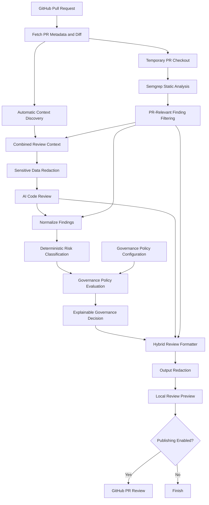

# AI PR Governor

AI-powered pull request review and engineering governance system combining LLM reasoning, static analysis, and deterministic risk-based controls.

AI PR Governor goes beyond traditional automated code review by separating AI-assisted analysis from governance decisions. It combines independent security evidence, context-aware reasoning, and configurable organizational policies to provide transparent and explainable recommendations.

## Features

### Intelligent Code Review

- AI-powered pull request analysis using OpenAI.
- Structured AI responses validated with Zod.
- Automatic discovery of relevant repository context.
- Context-aware analysis of dependencies and function references.
- Configurable OpenAI model selection.
- Identification of potential correctness, security, reliability, and business logic issues.

### Static Analysis

- Hybrid code review combining AI reasoning with Semgrep OSS.
- Temporary repository checkout at the exact pull request commit.
- Automatic cleanup of temporary repository files.
- File-level and line-level filtering of static analysis findings.
- Independent preservation of original Semgrep findings and severity levels.

### Risk Classification and Governance

- Unified severity normalization across AI and Semgrep findings.
- Deterministic pull request risk classification.
- Configurable governance policies: permissive, standard, and strict.
- Explainable governance decisions with supporting evidence.
- Risk-based human review and merge-blocking recommendations.
- Separation of AI reasoning from deterministic policy evaluation.

### Security and Human Oversight

- Pattern-based credential redaction before AI requests and review publishing.
- Instructions that treat repository content as untrusted input.
- Human-in-the-loop review with explicit publishing controls.
- Consolidated GitHub reviews containing AI findings, static analysis evidence, and governance assessments.

## Review Pipeline



Static analysis findings are preserved independently of the AI response, ensuring that rule-based security evidence remains visible to human reviewers.

The governance engine applies deterministic policies to the normalized findings rather than delegating governance decisions directly to the LLM.

## Risk Classification and Governance

Findings from OpenAI and Semgrep are normalized into a common data model while preserving their original severity and source.

The overall pull request risk is currently determined by the highest normalized finding severity.

### Risk Levels

| Risk | Description |
|---|---|
| Low | No findings or only low-severity findings |
| Medium | Potential correctness or reliability concerns |
| High | Significant potential security or business risks |
| Critical | Reserved for findings classified at the highest severity |

Critical risk is supported by the governance data model, but automatic critical-risk escalation is not yet implemented.

### Governance Policies

| Risk Level | Permissive | Standard | Strict |
|---|---|---|---|
| Low | Allow | Allow | Allow |
| Medium | Allow | Allow | Human review |
| High | Human review | Human review | Block recommended |
| Critical | Human review | Block recommended | Block recommended |

The governance policy can be configured through an environment variable:

```dotenv
GOVERNANCE_POLICY=standard
```

Supported values:

- `permissive`
- `standard` (default)
- `strict`

Unsupported policy names are rejected rather than silently falling back to another policy.

### Explainable Decisions

Every governance decision includes:

- Applied policy
- Overall risk level
- Recommended action
- Human approval requirements
- Supporting decision reasons

For example:

```text
Policy: strict
Risk level: HIGH
Recommended action: block
Human approval required: Yes

Decision reasons:
- Applied governance policy: strict.
- Overall PR risk: HIGH.
- Recommended action: block.
- [SEMGREP] app/config.py: Stripe API Key detected
```

Governance decisions are currently advisory. The application does not automatically approve pull requests or enforce merge restrictions.

## Technology Stack

| Technology | Purpose |
|---|---|
| TypeScript | Application development |
| Node.js | Application runtime |
| OpenAI API | Context-aware AI code review |
| Octokit | GitHub API integration |
| Semgrep OSS | Rule-based static analysis |
| Zod | Structured output validation |
| Vitest | Automated testing |
| Mermaid | Architecture documentation |

## Getting Started

### Prerequisites

- Node.js with support for `--env-file`
- npm
- Git
- Semgrep OSS
- GitHub personal access token
- OpenAI API key

### Installation

Clone the repository:

```bash
git clone https://github.com/jejegoscenko/ai-pr-governor.git
cd ai-pr-governor
```

Install dependencies:

```bash
npm ci
```

Install Semgrep on macOS:

```bash
brew install semgrep
```

Verify the installation:

```bash
semgrep --version
```

The application uses Semgrep's automatic rule configuration. An internet connection may be required to retrieve rules.

### Environment Configuration

Create a local environment configuration file:

```bash
cp .env.example .env
```

Configure the following environment variables:

```dotenv
GITHUB_TOKEN=your_github_token
GITHUB_OWNER=repository_owner
GITHUB_REPO=repository_name
GITHUB_PR_NUMBER=1

OPENAI_API_KEY=your_openai_api_key
OPENAI_MODEL=gpt-5.6

GOVERNANCE_POLICY=standard
PUBLISH_REVIEW=false
SKIP_AI_REVIEW=false
```

The selected OpenAI model must support Structured Outputs and be available to your API account.

The GitHub token requires read access to repository contents and pull requests. Publishing reviews requires write access to pull requests.

The target repository must also be accessible to Git for the temporary checkout.

Never commit the private `.env` file or real credentials.

## Running a Hybrid Review

Build the application:

```bash
npm run build
```

### Local Review Preview

Run a complete hybrid review without publishing to GitHub:

```bash
PUBLISH_REVIEW=false SKIP_AI_REVIEW=false node --env-file=.env dist/index.js
```

### Static Analysis Only

Run static analysis independently, without calling OpenAI:

```bash
node --env-file=.env dist/analysis/test-scan.js
```

### Context Discovery Only

Test repository context discovery without executing the AI review or static analysis:

```bash
SKIP_AI_REVIEW=true PUBLISH_REVIEW=false node --env-file=.env dist/index.js
```

### Apply a Strict Governance Policy

```bash
GOVERNANCE_POLICY=strict PUBLISH_REVIEW=false SKIP_AI_REVIEW=false node --env-file=.env dist/index.js
```

### Publish a Governance Review to GitHub

```bash
GOVERNANCE_POLICY=strict PUBLISH_REVIEW=true SKIP_AI_REVIEW=false node --env-file=.env dist/index.js
```

Publishing is disabled by default.

Published reviews are informational and do not automatically approve pull requests, request changes, or block merges.

Hybrid reviews incur OpenAI API usage costs. Repeated publishing may create duplicate reviews.

## Project Structure

```text
ai-pr-governor/
├── src/
│   ├── analysis/       # Semgrep integration and finding filtering
│   ├── github/         # GitHub API, checkout and review publishing
│   ├── governance/     # Risk classification and policy evaluation
│   ├── llm/            # AI reviewer and structured output schema
│   ├── review/         # Diff parsing and context discovery
│   ├── security/       # Sensitive credential redaction
│   └── index.ts        # Application entry point and orchestration
├── .env.example
├── .gitignore
├── package.json
├── tsconfig.json
├── vitest.config.ts
└── README.md
```

## Security and AI Governance

AI PR Governor implements multiple safeguards around AI-assisted code review:

- Rule-based static analysis complements AI reasoning.
- Original Semgrep findings and severity levels are preserved.
- Repository content is treated as untrusted input in AI instructions.
- Recognized credential patterns are redacted before AI requests and review output.
- Structured AI responses are validated using Zod.
- Governance policies are evaluated independently of the LLM.
- Invalid policy configurations are explicitly rejected.
- Publishing requires explicit activation.
- All findings require human verification.

These safeguards represent a defense-in-depth approach to AI-assisted engineering workflows.

## Testing

The project uses Vitest for automated unit and component integration testing.

Run all automated tests:

```bash
npm test
```

Verify TypeScript compilation:

```bash
npm run build
```

Test coverage includes:

- GitHub review publishing
- Temporary repository checkout and cleanup
- Diff parsing
- Automatic repository context discovery
- Semgrep output parsing
- File-level and line-level finding filtering
- Sensitive credential redaction
- Severity normalization
- Deterministic risk classification
- Governance policy configuration
- Policy evaluation
- Governance pipeline integration
- Review formatting

Automated tests use synthetic data and mocked external dependencies where appropriate, avoiding paid AI requests during routine testing.

## Known Limitations

- Governance decisions are advisory; actual merge enforcement is not implemented.
- Risk classification uses the highest individual severity rather than cumulative risk scoring.
- Critical-risk escalation rules and policy versioning are not yet implemented.
- Incomplete analysis is not yet explicitly represented in the governance data model.
- AI-generated findings may vary between executions and contain false positives.
- Pattern-based redaction does not detect every possible secret.
- Prompt instructions do not guarantee prompt injection protection.
- Static analysis does not guarantee that code is secure.
- Line-level filtering currently checks only the starting line of each finding.
- Findings in files without available diff patches may be excluded.
- Duplicate findings across review engines are not yet consolidated.
- Duplicate-review prevention is not yet implemented.
- Repository checkout assumes Git can access the target repository.
- This project is currently a portfolio implementation, not a production-ready security enforcement system.

## Development Roadmap

- [x] Milestone 1 — GitHub PR integration
- [x] Milestone 2 — AI reviewer and Structured Outputs
- [x] Milestone 3 — Automatic context-aware review
- [x] Milestone 4 — GitHub review publishing
- [x] Milestone 5 — Static analysis integration
- [x] Milestone 6 — Risk classification and governance
- [ ] Milestone 7 — GitHub Actions automation
- [ ] Milestone 8 — Reliability and observability
- [ ] Milestone 9 — Testing and benchmarking
- [ ] Milestone 10 — Portfolio documentation and demo

## License

MIT
